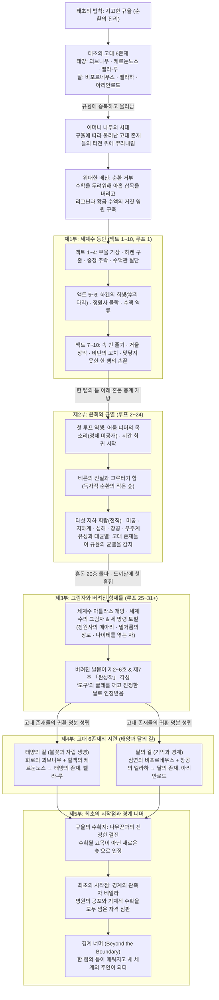

# LIGNIN(리그닌) — 스토리 전면 개편 & 루프 전환 연출 확정 규격 (2026-11-19)

> **상태: 사용자 확정 시안 (실제 게임 런타임 미반영 · 구현 대기)**
> 기준일: 2026-11-19 (`origin/main` `34e96be` 기준)
>
> 이 문서는 실제 게임 코드에 반영하기 전 확정된 **스토리·문체 개편안**과 **루프 전환 연출 + 인터랙티브 해금 화면 규격**의 단일 출처입니다.
> 다른 에이전트나 후속 구현 작업은 이 문서와 아래 확정 산출물을 기준으로 바로 구현을 이어갈 수 있습니다.

## 확정 산출물 목록

| 파일 | 역할 | 실제 게임 반영 여부 |
| --- | --- | --- |
| [`artifacts/loop-cinematic/first-loop-preview.html`](../artifacts/loop-cinematic/first-loop-preview.html) | 32비트 픽셀아트 + 실시간 60fps WebGL GLSL 셰이더 첫 루프/2루프+ 인터랙티브 프리뷰 (단일 파일, 모든 자산 base64 내장) | 시안 (미반영) |
| [`artifacts/loop-cinematic/loop-pixel-abyss.webp`](../artifacts/loop-cinematic/loop-pixel-abyss.webp) | Act 1 정적 배경 (1376×768, 32비트 픽셀아트, 인게임 맵 화풍 일치, 인물/얼굴 없음) | 구현 시 `assets/`로 이관 예정 |
| [`artifacts/loop-cinematic/loop-pixel-rewind.webp`](../artifacts/loop-cinematic/loop-pixel-rewind.webp) | Act 2 각성 배경 (1376×768, Act 1과 픽셀 단위 완전 정렬, 석조 고리 소용돌이 + 좌청록/우금빛 회로맥) | 구현 시 `assets/`로 이관 예정 |

---

# 제1부. LIGNIN(리그닌) 세계관 통합 및 대서사 스토리·문체 개편안

> **“영원을 탐한 나무는 안쪽부터 돌처럼 굳어 간다. 그 심재를 가를 날붙이는, 나무의 바깥이 아니라 나무가 버린 진흙 속에서 태어난다.”**

## 1. 핵심 컨셉과 제목의 비밀: 왜 「LIGNIN」인가?

식물학에서 **리그닌(Lignin)**은 부드러운 식물 세포벽에 스며들어 줄기를 단단한 목질(木質)로 굳히는 물질입니다. 나무가 하늘 끝까지 거대하게 솟구쳐 서게 해 주는 힘이자, 동시에 **살아 숨 쉬던 세포를 딱딱하게 굳혀 죽음에 이르게 하는 양날의 물질**입니다.

이 게임의 전체 신화는 바로 이 이중성 위에 서 있습니다.

- **어머니 나무(세계수)**는 때가 되면 아홉 삽목(가지)에게 생명을 물려주고 물러나야 하는 **「지고한 규율(순환의 진리)」**을 거부했습니다.
- 영원히 서 있고자 스스로를 리그닌과 황금 수액의 결계로 굳힐수록, 겉모습은 찬란해졌지만 **속은 텅 비어 썩어 가는 거대한 감옥**이 되었습니다.
- 플레이어는 바로 그 나무가 실패작이라 버린 낙과이자, 나무를 베어낼 규율의 집행자가 벼려다 버린 **「첫 번째 날붙이」**로서, 우물 밑바닥 진흙에서 기어올라 **어머니 나무의 거짓 영원 → 나무꾼의 기계적 수확 → 고대 6존재의 신화적 시험**을 모두 넘어 **최초의 경계 너머에 스스로 새로운 숲을 여는 존재**가 됩니다.

## 2. 현재 스토리 충돌 진단과 단일 신화 통합 해법

현재 저장소에는 초기 설정(모루와 날붙이 1~7호)과 최근 아틀라스 개편 설정(어머니 나무의 순환 거부 + 고대 6존재 + 검은 불꽃)이 반쯤 섞여 있습니다. 최신 개편 설정을 정사의 뼈대로 세운 뒤 기존 요소를 하나의 자연스러운 신화로 엮습니다.

| 충돌 지점 | 기존 상태 (혼재·모순) | 개편안의 통합 해법 (단일 신화) |
| :--- | :--- | :--- |
| **주인공의 정체** | ‘나무꾼의 모루에서 떨어진 강철 날붙이 1호’ vs ‘어머니 나무의 삽목 낙과’ 충돌 | **「날붙이가 된 낙과」**: 원래 어머니 나무의 아홉 삽목 중 가장 먼저 떨어져 나온 **첫 번째 낙과**. 나무꾼과 오르가가 어머니 나무의 리그닌 껍질을 안쪽에서 베기 위해, 이 낙과를 **탄화모루(불에 탄 나무 모루)** 위에서 날붙이로 벼리려다 실패작으로 내버린 **제1호**다. |
| **정원사의 성격** | 저널에서는 ‘바깥의 도끼를 막으려 희생한 비극적 관리자’ vs NPC 대사에서는 ‘후임자 베른의 눈을 파낸 광신도’ | **「비극적 타락과 광신」**: 본래 금빛 심안을 지닌 충직한 관리자였으나, 하켄의 제1차 반란(검은 불꽃)과 바깥 도끼 소리에 공포를 품고 변절. “내가 아니면 어머니를 지킬 수 없다”는 오만으로 **진짜 후임자 베른의 눈을 도려내고** 거짓 영원을 맹신하게 된 비극적 폭군. |
| **하켄의 정체** | ‘주인공을 암살용 무기로 키운 흑막’ vs ‘과거 검은 불꽃으로 반란을 일으킨 드루이드’ | **「제1차 반란자이자 스스로 숫돌이 된 스승」**: 괴브니우의 화로에서 스며 나온 **검은 불꽃**을 들고 순환을 되돌리려다 어머니 나무의 기적에 유폐된 선구자. 자신이 오르지 못하는 중정을 부수기 위해 우물에 떨어진 ‘다른 점’을 냉혹하게 담금질하고, 5막에서 자신의 심장과 생명을 마지막 다리로 바친다. |
| **10막 ‘맞닿지 못한 손끝’** | 고치의 존재가 왜 검을 거두고 주인공에게 손을 뻗는지 감정적 이유 불명확 | **「잃어버린 반쪽과의 재회」**: 아홉으로 갈라져야 했던 삽목 중, 주인공(제1호 낙과)이 떨어져 나간 뒤 버림받은 나머지 의지들이 서로를 자양분 삼아 하나로 뒤엉킨 고치. 홀로 온전한 모습으로 걸어 올라온 자신의 반쪽을 알아보고 구원과 자유를 바라며 손을 뻗지만, 주인공이 아직 ‘나무꾼의 도구’에서 벗어나지 못해 **한 뼘의 틈**이 남는다. |
| **나무꾼의 역할** | 혼돈 5층에서는 ‘수확될 묘목을 시험하는 수확자’ vs 혼돈 밖에서는 ‘첫 번째 날붙이의 주인’ | **「규율의 수확자이자 탄화모루의 주인」**: 지고한 규율을 어긴 어머니 나무를 수확하기 위해 도끼를 든 존재. 바깥의 도끼로는 리그닌 결계를 깰 수 없어 낙과 7개를 탄화모루에서 벼려 투입했다. 루프 초기엔 주인공을 ‘도끼의 부품’으로 담금질하지만, 태양·달의 고대 6존재를 모두 넘은 주인공 앞에서 비로소 **“수확될 묘목도, 내 도끼의 날도 아닌 스스로 서는 새로운 숲”**으로 인정한다. |
| **혼돈 5층 시뮬레이터 복선** | 혼돈 5층 첫 돌파 시 `woodsman_simulator_loop`(`나무꾼의 시뮬레이터`) 안내가 떠서 1루프 말의 미스터리를 미리 노출함 | **완전 삭제 (사용자 확정)**: [`modules/combat/zone-completion.mjs`](../modules/combat/zone-completion.mjs)에서 `queueTutorialNotice('woodsman_simulator_loop', ...)` 호출을 삭제한다. 단, `chaosInfuserUnlocked` 개방과 관련 저널 해금 흐름은 그대로 유지한다. |
| **극점 보스명 & 고유 장비명** | `벨라-루/비포르네우스/엘라하/아리안로드`와 구 명칭 `모르그란/탈라사/카엘룸/아스트라` 혼용 | **공식 보스명은 고대 6존재로 완전 통일**. 저장 키로 고정된 고유 장비 이름(`모르그란의 용광로 흉갑`, `탈라사의 해구 이빨`, `아스트라의 파편`)과 전투 표식은 **각 고대 존재의 옛 권역·유물 이름**으로 자연스럽게 녹여 냄(모르그란=벨라-루의 용광로, 탈라사=비포르네우스의 검은 해구, 아스트라=아리안로드가 엮은 다섯 별의 잔향). |
| **9막 일러스트 역전** | `act-9-start.webp`(고치 개화)와 `act-9-end.webp`(장막 찢어짐·황금 수관)가 텍스트와 반대로 연결됨 | **9막 시작 = 장막이 찢어지며 황금 수관이 열리는 그림**, **9막 종료 = 접목의 어머니 품에서 고치가 갈라지며 존재가 승천하는 그림**으로 정상 교정. |

## 3. 전체 신화 구조 & 5부작 대서사 흐름도



## 4. 신화 연대기 (Timeline)

### 제0시대 — 태초의 여섯 존재와 지고한 규율
- 어머니 나무가 싹트기 전, 세계는 **태양의 세 존재**(화로의 괴브니우, 혈맥의 케르눈노스, 태양의 벨라-루)와 **달의 세 존재**(심연의 비포르네우스, 창공의 엘라하, 달의 아리안로드)가 다스리는 광활한 태고의 터전이었다.
- 그들은 각기 **정화의 검은 불꽃(괴브니우)**, **자립하는 군집 생명(케르눈노스)**, **지핵의 용광로(벨라-루)**, **지워지지 않는 심연의 기억(비포르네우스)**, **창공의 방벽(엘라하)**, **별과 시간의 은빛 차륜(아리안로드)**을 관장했다.
- 우주의 최상위 법칙인 **「지고한 규율(순환의 진리)」**에 따라 시대가 다한 고대 존재들은 각자의 극점으로 물러났다. 다만 그들이 남긴 **다섯 지하 회랑(전직 시련)**과 **다섯 터전(아틀라스)**만은 어머니 나무의 뿌리를 거부하며 독립된 의지를 품은 채 남았다.

### 제1시대 — 어머니 나무의 개화와 황금의 규율
- **최초의 시작점**에 뿌리내린 어머니 나무는 황금 수액으로 거대한 세계를 꽃피웠다.
- 본래 어머니 나무의 사명은 **아홉 개의 삽목**을 길러내어, 때가 차면 스스로 줄기를 찢고 갈라져 **아홉 그루의 새로운 숲**으로 번성하게 한 뒤 규율의 수확자 **나무꾼**의 도끼 아래 조용히 물러나는 것이었다.
- 대리인으로 금빛 심안을 지닌 **정원사**를 세웠고, 후임자로 **베른**을 맺어 두었다.

### 제2시대 — 영원의 공포, 제1차 반란과 정원사의 타락
- 수확의 계절이 다가오며 세계수 바깥에서 나무꾼의 발소리가 울리자, **어머니 나무는 소멸에 대한 공포로 순환을 거부했다.**
- 아홉 삽목으로 향하던 수액은 차단되었고, 하층 뿌리(허공뿌리 · 지주근)의 생명력을 쥐어짜 중정과 수관의 영원만을 지탱하는 기생 구조가 세워졌다.
- **제1차 반란**: 지주근의 드루이드 **하켄**이 지하 화로(괴브니우의 잔향)에서 **검은 불꽃**을 이끌어 내어 중정을 태우려 했으나, 어머니 나무의 기적으로 지하에 유폐되었다.
- **정원사의 변절**: 정원사는 원래의 목령을 전실 깊숙이 숨기고 거짓 목령을 꾸며 **베른의 두 눈을 도려낸 뒤** 눈먼 채화꾼으로 전락시켰다.
- **비탄의 고치**: 가장 먼저 떨어진 **하나의 낙과(주인공)**를 제외한 나머지 삽목 의지들은 거울 장막 뒤에서 서로를 자양분 삼아 하나의 고치로 뭉쳤고, **비탄하는 접목의 어머니**가 붉은 눈물로 그 고치를 품었다.

### 제3시대 — 탄화모루와 일곱 개의 날
- 바깥의 도끼만으로는 리그닌 결계를 벨 수 없었던 **나무꾼**은 **벼림꾼 오르가**의 **탄화모루** 위에서 나무 안쪽을 가를 **일곱 개의 날붙이**를 벼렸다.
  - **제1호 (주인공 / 다른 점 / 삽목의 낙과)**: 첫 번째 삽목 낙과에 검은 불꽃 잔향이 스민 파편. 실패작으로 밑거름의 우물에 내버려졌다.
  - **제2~6호 (과열 · 무딤 · 탐식 · 잔영 · 역린)**: 결함 탓에 폐기되어 모루터 지하 감옥에 봉인된 시제품들.
  - **제7호 (완성작)**: 모든 결함을 도려내어 나무꾼이 끝내 손에서 놓지 않고 봉인해 둔 최종작.

### 제4~5시대 — 우물 속 각성, 윤회의 사슬, 고대 존재의 귀환과 「경계 너머」
- 폐기된 제1호가 우물에서 깨어나 세계수를 등반하고 10막에서 한 뼘의 틈을 남긴 채 혼돈 층계로 내려선다.
- 첫 루프가 돌아가며(어둠 너머의 목소리는 아직 정체를 드러내지 않음) 윤회가 거듭되고, 세계수의 껍질이 갈라지며 고대 6존재의 귀환 명분이 열린다.
- 버려진 형제 제2~7호, 태양의 길(괴브니우·케르눈노스·벨라-루)과 달의 길(비포르네우스·엘라하·아리안로드), 나무꾼, 경계의 관측자 베일라를 넘어 마침내 한 뼘의 틈을 메우고 **「경계 너머」**에 스스로의 시대를 연다.

## 5. 핵심 세력 및 인물 열전 & 루프 인지 계약

| 인물 | 루프 인지 | 핵심 서사 역할 | 고정 말투 |
| :--- | :--- | :--- | :--- |
| **주인공 (6직업)** | 본인 기억 유지 | 버려진 제1호 낙과 · 여섯 추방자의 의지 | 6직업별 개성 고정(전사 단호, 방랑자 시니컬 반말, 궁수 냉정, 성직자 엄숙 경어, 비술사 고고한 학자, 연금술사 나긋·서늘 존댓말) |
| **하켄 (`haken`)** | 모름 | 제1차 반란자 · 숫돌이 된 스승 · 5막 뿌리 다리 희생 | 묵직한 노인 하게체 (`자네`, `~네 / ~걸세 / ~게`) |
| **베른 (`bern`)** | 모름 (손끝 위화감) | 빼앗긴 진짜 후임자 · 그루터기 함 전수 | 온화하고 정갈한 수도사 하오체 (`그대`, `~오 / ~소 / ~지`) |
| **정원사** | 모름 | 공포에 변절한 광신 관리자 · 6막 침묵 속 몰락 | 엄숙·광신 어투 |
| **오르가 (`orga`)** | 모름 (벼림 자국 경악) | 탄화모루 외팔이 사념 · 일곱 날붙이와 고대 회랑의 다리 | 호탕·직설 대장장이 어투 (`이봐 / 자네`, `~지 / ~군 / ~어`) |
| **이벨 (`ivel`)** | 모름 (장막 기록 경악) | 중정 부제 출신 배교자 · 삽목 탈출과 금기 기술 안내 | 시니컬·솔직 반말 (`너`, `~어 / ~지 / ~거든`) |
| **나무꾼 (`woodsman`)** | **완전 인지** | 규율의 수확자 · 탄화모루 주인 (**루프 1에서는 얼굴·정체 비공개**) | 위엄·단호 반말 (`너`, `~다 / ~느냐 / ~라`) |
| **베일라 (`veila`)** | **완전 인지** | 최초의 시작점 기록관 · 최종 심판자 | 정중·서늘 경어체 (`당신`, `~합니다 / ~하십시오 / ~군요`) |

## 6. 문체·어투 자연화 원칙 (번역투·어색한 표현 일괄 교정 기준)

1. **번역투·직역체·기계 어투 제거**
   - `달아보다`(weigh 직역) → `시험해 보자` / `직접 확인하겠습니다`
   - `관측을 종료합니다` → `관측을 마칩니다`
   - `하나의 신경망으로 움직인다` / `자동 집행자` → `한 몸처럼 움직인다` / `빈 왕좌의 수호자`
   - `서슬` 과다 반복 → 맥락에 따라 `칼끝 · 날 · 기세 · 실력`으로 분산
2. **오용 한자어·비표준어 교정**
   - `호혜를 잃은` → `은총을 잃은` / `축복이 끊긴`
   - `낙과된 너를` → `가지에서 떨어진 너를` / `버려진 너를`
   - `어긋내게 되면서` → `어기면서`
   - `순환을 거절하는` → `순환을 거부하는`
   - `황금 수액의 축도를 받소` → `황금 수액의 축복을 받소`
   - 조사 오류(`벨라-루을`, `엘라하을`, `다른 점가`, `후임자은`) 전면 교정
3. **전투/화면 대사 계약 준수**
   - [`modules/data/story-journal.mjs`](../modules/data/story-journal.mjs) 규칙: 화면 대사 **50자 이내**, `·` / `・` / `—` / `―` 금지.
   - 기존 한국어 저장 키(장비 부위, 고유 장비명 등)는 절대 변경하지 않음([`docs/i18n.md`](i18n.md)).

## 7. 스토리 개편 반영 대상 파일

1. [`docs/story-bible.md`](story-bible.md): 최신 정사·5부작·고대 6존재·인물별 말투 기준으로 전면 정비.
2. [`modules/data/story-journal.mjs`](../modules/data/story-journal.mjs):
   - `act_9_start` / `act_9_end` 일러스트 역전 교정(`act-9-end.webp` ↔ `act-9-start.webp`).
   - 전 항목(`SUPPLIED_STORY_SCENES`, `STORY_CLASS_ORIGINS`, `STORY_NPCS`, `STORY_ACT_ENCOUNTERS`, `STORY_TRIAL_ENCOUNTERS`, `STORY_LOOP_MILESTONES`, `STORY_ENDGAME_ENCOUNTERS`) 자연화 및 신화 통일.
3. [`modules/data/maps.mjs`](../modules/data/maps.mjs): `STORY_ACTS` 및 `JOURNAL_DB` 38종 보스명 통일, 조사 오류·번역투 교정.
4. [`modules/data/atlas-endgame.mjs`](../modules/data/atlas-endgame.mjs) & [`modules/data/world-map.mjs`](../modules/data/world-map.mjs): 아틀라스 보스 스토리 정교화 + 비어 있는 6개 지역 설명(`심해`, `지하계`, `혼돈계`, `우주계`, `군락지`, `창공`) 작성.
5. [`modules/combat/zone-completion.mjs`](../modules/combat/zone-completion.mjs): 혼돈 5층 `queueTutorialNotice('woodsman_simulator_loop', ...)` (`나무꾼의 시뮬레이터`) **완전 삭제** (`chaosInfuserUnlocked` 및 저널 해금은 유지).
6. [`modules/data/locales/`](../modules/data/locales/): 변경·추가된 한국어 원문 키 동기화 (`npm run check:i18n`).

---

# 제2부. 루프 전환 연출 & 인터랙티브 해금 화면 확정 규격

## 1. 사용자 확정 절대 원칙 (불변 계약)

1. **화풍 일치 (32비트 픽셀아트)**:
   - 인게임 맵([`assets/ui/region-cards/chaos.webp`](../assets/ui/region-cards/chaos.webp), [`assets/ui/region-cards/roots.webp`](../assets/ui/region-cards/roots.webp), [`assets/stage-scenes/root-end-v5/backdrop.png`](../assets/stage-scenes/root-end-v5/backdrop.png))과 완전히 일치하는 32비트 픽셀아트 화풍만 사용한다.
   - 확정 배경 2장: [`loop-pixel-abyss.webp`](../artifacts/loop-cinematic/loop-pixel-abyss.webp)(Act 1 정적) & [`loop-pixel-rewind.webp`](../artifacts/loop-cinematic/loop-pixel-rewind.webp)(Act 2 각성, 픽셀 단위 완전 정렬).
2. **기존 게임 UI 그대로 재사용**:
   - [`css/themes/pixel.css`](../css/themes/pixel.css)의 `hud-window.png`(26px 켈트 매듭 테두리), `hud-panel.png`, `hud-panel-dark.png`, 청동 베벨 `.px-btn`, `Galmuri11`/`Galmuri14` 픽셀 글꼴, `border-radius: 0`을 그대로 사용한다.
   - 해금 트리는 [`css/unlock-tab.css`](../css/unlock-tab.css)의 기존 계열 색(`fam-gear #d8a46a`, `fam-rune #8fb4ee`, `fam-growth #93d18c`), `.unlock-card`, `.unlock-pip`, 직교 SVG 연결선, `.unlock-act.is-go`, `보조스킬룬` 보상 선택 `<select>` 문법을 그대로 따른다.
3. **나무꾼 미공개 (루프 1 미스터리 유지)**:
   - 첫 루프 연출에서 나무꾼의 얼굴·체형·보스 스프라이트를 절대 보여주지 않는다. 화자 표기는 `어둠 너머의 목소리`로 유지한다.
4. **100% 순한국어**:
   - 화면 어디에도 인위적인 영어·사이버 전문어(`CYCLE_`, `REWRITE`, `MATRIX`, `NODE::`, `VEILA_`, `LIVE_LINK`, `HANDOFF`, `BYPASS`, `LOOP II` 등)를 쓰지 않는다. 모든 화면 문구는 `_t('한국어 원문')` / `data-i18n`으로 처리한다.
5. **PC·좁은 창·모바일(390px) 전면 스크롤리스 (`overflow: auto` 0개)**:
   - CSS Container Queries(`@container`)로 화면 너비에 따라 자동 전환한다.
   - **넓은 화면(`> 720px`)**: 유동 3열 직교 SVG 트리(`ResizeObserver`로 연결선 실시간 재계산) + 하단 상세·보상·해금 바.
   - **좁은 화면/모바일(`<= 720px`)**: 단일 화면 무스크롤 3계열 트리(부모 + `└` 들여쓰기 자식 노드) + 컴팩트 하단 상세·해금 바. 어떤 해상도에서도 글씨 흘러내림이나 내부 스크롤바가 생기지 않아야 한다.

## 2. 4막 연출 시퀀스 & 빈도 규칙

### 첫 루프 (루프 1 → 루프 2, 최초 1회 풀 시퀀스)
- **Act 1 — 한 뼘의 정적** (`loop-pixel-abyss.webp`):
  - 시네마 레터박스 + 보랏빛 별구름 틈새 미세 반짝임 + 부유하는 픽셀 십자 별빛(`+`).
  - `어둠 너머의 목소리` 3줄 대사(타자기 + 클릭/스페이스바 진행, 우상단 건너뛰기).
- **Act 2 — 차륜 역행 각성** (WebGL GLSL 셰이더 전환: `loop-pixel-abyss.webp` → `loop-pixel-rewind.webp`):
  - `0~330ms`: 석조 고리 중심(`RING_C = vec2(0.499, 0.245)`, `texAspect = 1376.0 / 768.0`)으로 중력 렌즈 수축 + 떨어지던 별빛 정지.
  - `330ms+`: 색수차 + 픽셀 수평 스캔라인 글리치를 동반한 원형 충격파가 고리에서 바깥으로 퍼지며 `Scene A → Scene B`로 픽셀 단위 점화.
  - 지속 상태: 석조 고리 내부(`r < 0.128`, `smoothstep(0.128, 0.105, r)`)만 도트 격자 양자화(`480×270`)로 반시계 회전(석조 테두리는 절대 흔들리지 않음) + 두 텍스처 차분 `max(colB - colA, 0.0)` 마스크를 따라 모든 뿌리·오벨리스크·바닥 원진 회로맥으로 에너지 파동 이동 + 역중력 픽셀 빛줄기 상승.
  - 고리 아래(`top: 47%`) 한국어 시간 역행 카운터(`혼돈 10층 → … → 우물 바닥 → 루프 2 · 도착`).
- **Act 3 — 인터랙티브 해금 화면 (루프 전환 직후)**:
  - 레터박스 해제 + 청록·금빛 스캔라인으로 실제 게임 `hud-window` 해금 패널 등장(배경은 살아 움직이는 Scene B를 은은하게 감광).
  - `+2P` 롤업 연출(`0P → 2P`), 카드 호버 시 직교 SVG 선행 경로 강조(`is-path`), `보조스킬룬` 보상 선택(`가속`/`무자비`/`생명력 흡수`) + 실제 `support-rune-icons-64` 픽셀 아이콘 연동.
  - 해금 클릭 시 실제 `contentUnlockUi.purchase(id, scope)` 호출 + 카드 좌표 픽셀 스파크 버스트 + 배경 WebGL 2차 회로맥 파동(`uPulseWave`) 발사.
  - 하단 버튼: `다음 루프로` (또는 포인트 미사용 시에도 언제든 진행 가능).
- **Act 4 — 영웅 선택 전환**:
  - 기존 `#loop-hero-select-overlay`로 매끄럽게 핸드오프.

### 루프 2 이상 (반복 피로 방지 규칙)
- **조건부 해금 표시**: 미사용 해금 포인트가 있고 즉시 해금 가능한 노드가 존재하며 **`autoLoop`가 OFF**인 경우에만 짧은 역행(약 1.1s) 뒤 즉시 해금 패널 표시.
- **자동 루프(`autoLoop` ON) 또는 해금 가능 항목 없음**: 해금 창을 띄우지 않고 약 1.3s의 비차단(non-blocking) 역행 셰이더 연출만 재생하고 바로 다음 루프로 진행.
- **연출 줄이기(`reduced-effects`) / WebGL 미지원 환경**: 2D Canvas 폴백과 정적 페이드 전환을 지원.

## 3. 실제 게임 코드 연결 지도 (구현 시 참조)

| 영역 | 대상 원본 파일 | 구현 책임 |
| --- | --- | --- |
| 배경 자산 | `assets/ui/loop-pixel-abyss.webp`, `assets/ui/loop-pixel-rewind.webp` | `artifacts/loop-cinematic/`의 확정 WebP 2장 이관 |
| 루프 전환 훅 | [`modules/domain/loop-transition.mjs`](../modules/domain/loop-transition.mjs) | `loopSave`(line 55) 직후, `loopFlowRequestLoopHeroSelection`(line 57) 직전에 시네마틱·해금 단계 훅 삽입 (저장 커밋 후 실행이므로 새로고침·종료에도 포인트/상태 안전) |
| 시네마틱 & WebGL 셰이더 | 신규 `modules/ui/loop-cinematic-ui.mjs` (동결 모듈 객체 `Object.freeze`) | `first-loop-preview.html`의 WebGL GLSL 셰이더 + 2D 폴백 + 음향(`assets/audio/game-sfx-v2/`) + 4막 시퀀스 + zero-scroll 해금 패널 구현. 최초 1회 여부는 `game.seenTutorials` 플래그(`first_loop_cinematic`)로 기록 |
| 해금 구매 연동 | [`modules/ui/content-unlock-actions.mjs`](../modules/ui/content-unlock-actions.mjs) | `contentUnlockUi.purchase(id, scope)` 직접 호출(중복 로직 금지), 시네마틱 해금 패널이 열려 있는 동안 중복 플로팅 해금 팝업만 억제 |
| 기존 루프 연출 업그레이드 | [`modules/ui/loop-settlement-reveal.mjs`](../modules/ui/loop-settlement-reveal.mjs) | 구형 파란 CRT 스캔라인 `playLoopRewriteEffect`를 새 픽셀아트 역행 톤과 일관되게 정리 |
| 스타일 | `css/features/` 또는 `css/components/` + [`css/main.css`](../css/main.css) | `css/tokens.css` 및 레이어 순서(`reset, base, components, features, overrides`) 준수, `data-tip` 계약 준수(`title` 금지) |
| 다국어 | [`modules/data/locales/`](../modules/data/locales/) | 새로 추가된 모든 `_t()` 한국어 원문 동기화 |

## 4. 구현 완료 시 필수 검증 체크리스트

```bash
npm run build:modules
node scripts/import-story-pack.cjs --check
npm run check:css
npm run check:i18n
npm run check:architecture
npm run check:types
npm test
```

- 추가 브라우저 검증: `npm run probe`로 **PC(1280×720+)**, **좁은 창**, **모바일(390×844)**에서 Act 1~4 및 루프 2+ 조건부 분기·`autoLoop` 분기·스크롤 0개·콘솔 오류 0개를 직접 확인한다.
